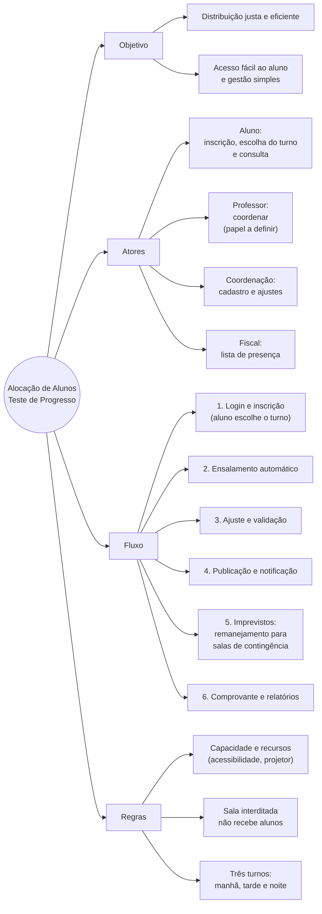

# Sistema de Alocação de Alunos para o Teste de Progresso

Visão resumida de objetivo, atores, fluxo e regras. Os detalhes estão em Histórias de Usuário e Análise de Tarefas.

## Controle do documento

| Data | Versão | Descrição | Autor(es) |
|---|---|---|---|
| (não registrada) | 1.0 | Documento original | Equipe |
| 14/11/2026 | 1.1 | Inclusão do turno, do remanejamento, da sala interditada, do comprovante e dos relatórios (já previstos nas Histórias e na Análise); papel "Professor" marcado como a definir | Equipe |
